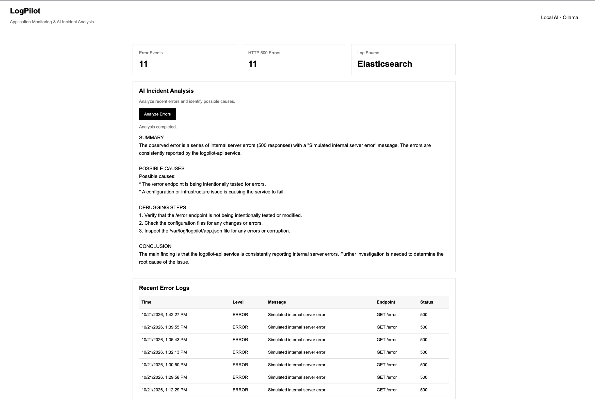

# LogPilot 

A Docker-based log monitoring and AI-powered incident analysis platform with a pure-Python app (FastAPI), the ELK Stack, and Ollama for local AI.

## Overview

LogPilot collects application logs, indexes them in Elasticsearch via Logstash, visualizes them in Kibana, shows them on a live dashboard, and uses a local LLM to analyze errors and suggest debugging steps.

### LogPilot Application Dashboard



## Features

- **Log Collection:** Captures application requests, errors, and HTTP status codes.
- **Centralized Logging:** App writes JSON logs → Logstash → Elasticsearch.
- **Kibana:** Search logs and build charts/dashboards.
- **No-Docker mode:** If `ELASTICSEARCH_URL` is unset, the app uses a built-in SQLite store.
- **Live Dashboard:** Error statistics and recent logs with automatic refresh.
- **AI Incident Analysis:** Ollama + Llama 3.2 analyze recent errors locally.
- **Containerized Option:** A single-service Docker Compose setup.

## Tech Stack

- Python 3.10+ — FastAPI, Uvicorn, httpx (all dependencies are in `requirements.txt`)
- Elasticsearch, Logstash, Kibana 8.17 (Docker images — infrastructure, not app dependencies)
- SQLite (stdlib fallback)
- Docker & Docker Compose
- Ollama — Llama 3.2 (separate local app, used over HTTP)
- HTML, CSS, JavaScript (static dashboard)

## Architecture

Python app → JSON logs (app.json) → Logstash → Elasticsearch → Kibana

Elasticsearch → Python app (`/api/stats`, `/api/errors`) → Dashboard

Elasticsearch errors → Ollama → AI Incident Analysis

## Getting Started

### Prerequisites

- Python 3.10+
- [Ollama](https://ollama.com) installed locally with the model: `ollama pull llama3.2`

### Run with Docker (full ELK DevOps stack)

```bash
docker compose up -d --build
ollama pull llama3.2
```

- Dashboard: http://localhost:3000
- Kibana: http://localhost:5601
- Elasticsearch: http://localhost:9200

### Using Kibana

1. Generate some logs: `curl localhost:3000/error` a few times and open the dashboard.
2. Open Kibana → **Stack Management → Data Views → Create data view**, pattern `logpilot-*`, timestamp field `@timestamp`.
3. Open **Discover** to search logs (e.g. `level : "ERROR"` or `statusCode : 500`).
4. Open **Dashboard / Visualize** to chart errors over time and status codes.

### Run locally without Docker (SQLite fallback)

```bash
python -m venv .venv && source .venv/bin/activate
pip install -r requirements.txt
python main.py
```

Open http://localhost:3000

### Configuration (environment variables)

| Variable | Default | Purpose |
|---|---|---|
| `PORT` | `3000` | HTTP port |
| `ELASTICSEARCH_URL` | *(unset)* | Use Elasticsearch (Compose sets it); unset = SQLite |
| `LOGPILOT_DATA_DIR` | `./data` | SQLite DB and JSON log location |
| `OLLAMA_URL` | `http://localhost:11434` | Ollama endpoint (Docker Compose sets `host.docker.internal`) |
| `OLLAMA_MODEL` | `llama3.2:latest` | Model used for analysis |

## Testing

```bash
curl -i http://localhost:3000/error      # generate a sample 500 error
curl http://localhost:3000/api/stats
curl http://localhost:3000/api/errors
curl -X POST http://localhost:3000/ai/analyze

pip install -r requirements-dev.txt && pytest
```

## Stop / reset

```bash
docker compose down        # add -v to also delete stored logs
```

## Future Improvements

- Advanced monitoring and alerting
- Improved incident classification
- Additional log sources (e.g. tailing Nginx access logs)
# LogLens
