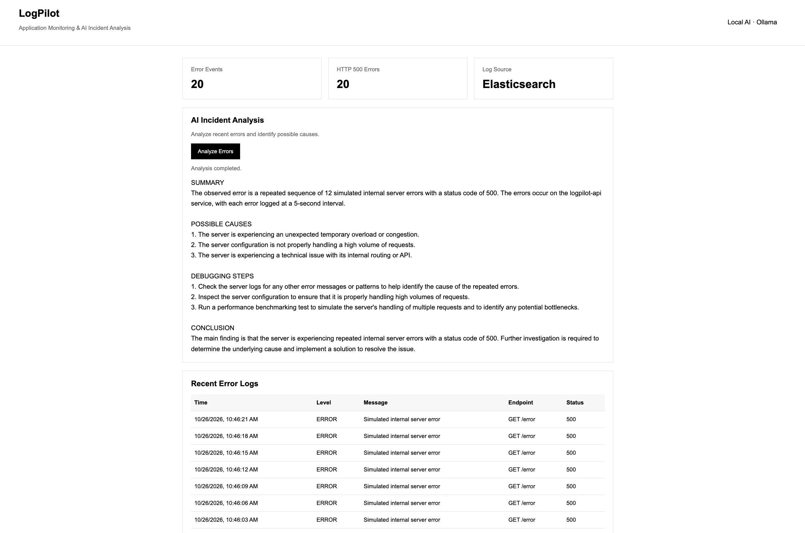
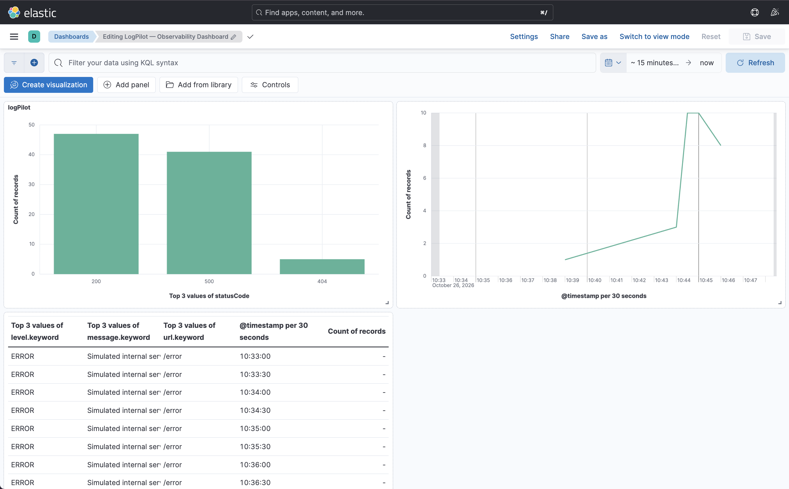

# LogLens — AI-Powered Log Monitoring & Incident Analysis

LogLens is a Docker-based log monitoring and AI-powered incident analysis platform built with FastAPI, the ELK Stack, and Ollama. It centralizes application logs, visualizes errors through a dashboard, and uses a local LLM to analyze incidents and suggest debugging steps.

## Overview

LogLens provides a centralized workflow for collecting, analyzing, and monitoring application logs. It integrates the ELK Stack for log processing and visualization with local AI-powered incident analysis.

## Screenshots

### Application Dashboard



### Dashboard View




## Features

- **Log Collection:** Captures application requests, errors, and HTTP status codes.
- **Centralized Logging:** Processes structured JSON logs using Logstash and Elasticsearch.
- **Interactive Dashboard:** Displays recent logs and error statistics with automatic refresh.
- **Log Visualization:** Search and visualize application logs using Kibana.
- **AI Incident Analysis:** Uses Ollama and Llama 3.2 to analyze recent errors locally.
- **SQLite Fallback:** Supports local execution without Elasticsearch.
- **Docker Support:** Runs the application and logging infrastructure using Docker Compose.

## Architecture

```text
                  ┌──────────────────┐
                  │   FastAPI App    │
                  └────────┬─────────┘
                           │
                    Structured Logs
                           │
                           ▼
                  ┌──────────────────┐
                  │     Logstash     │
                  └────────┬─────────┘
                           │
                           ▼
                  ┌──────────────────┐
                  │  Elasticsearch   │
                  └────────┬─────────┘
                           │
                  ┌────────┴─────────┐
                  ▼                  ▼
            ┌──────────┐       ┌──────────┐
            │  Kibana  │       │  Ollama  │
            │Dashboard │       │ Local AI │
            └──────────┘       └──────────┘
```

## Tech Stack

| Technology | Purpose |
|---|---|
| Python | Backend development |
| FastAPI | REST API |
| Elasticsearch | Log storage and search |
| Logstash | Log processing |
| Kibana | Log visualization |
| Ollama | Local AI inference |
| Llama 3.2 | Incident analysis |
| SQLite | Lightweight local storage |
| Docker Compose | Container orchestration |
| HTML, CSS, JavaScript | Dashboard interface |
| pytest | Testing |

## Prerequisites

- Python 3.10+
- Docker and Docker Compose
- [Ollama](https://ollama.com/) for AI incident analysis

Download the model:

```bash
ollama pull llama3.2
```

## Getting Started

### 1. Clone the Repository

```bash
git clone https://github.com/rutuja2005byte/LogLens.git
cd LogLens
```

### 2. Run with Docker Compose

Start the configured services:

```bash
docker compose up -d --build
```

Ensure Ollama is running and accessible to the application.

Access the services:

- **Application Dashboard:** http://localhost:3000
- **Kibana:** http://localhost:5601
- **Elasticsearch:** http://localhost:9200

### 3. Run Locally Without Docker

Create a virtual environment and install the dependencies:

```bash
python3 -m venv .venv
source .venv/bin/activate
python3 -m pip install -r requirements.txt
python3 main.py
```

Open http://localhost:3000.

In this mode, the application uses SQLite when `ELASTICSEARCH_URL` is not configured.

## API Testing

Generate sample errors and inspect the API responses:

```bash
# Generate a sample HTTP 500 error
curl -i http://localhost:3000/error

# Retrieve log statistics
curl http://localhost:3000/api/stats

# Retrieve recent errors
curl http://localhost:3000/api/errors

# Run AI incident analysis
curl -X POST http://localhost:3000/ai/analyze
```

## Kibana Setup

1. Generate sample logs using the `/error` endpoint.
2. Open Kibana at http://localhost:5601.
3. Navigate to **Stack Management → Data Views**.
4. Create a data view matching `logpilot-*`, using `@timestamp` as the time field, if these match your configured index names.
5. Open **Discover** to search logs and investigate errors.
6. Use Kibana dashboards to visualize error trends and HTTP status codes.

## Environment Variables

| Variable | Default | Description |
|---|---|---|
| `PORT` | `3000` | Application port |
| `ELASTICSEARCH_URL` | Unset | Elasticsearch endpoint; unset enables SQLite fallback |
| `LOGPILOT_DATA_DIR` | `./data` | Directory for local data and JSON logs |
| `OLLAMA_URL` | `http://localhost:11434` | Ollama API endpoint |
| `OLLAMA_MODEL` | `llama3.2:latest` | Model used for incident analysis |

## Testing

Install development dependencies and run the test suite:

```bash
python3 -m pip install -r requirements-dev.txt
pytest
```

## Stop the Services

```bash
docker compose down
```

To remove associated Docker volumes and their stored data:

```bash
docker compose down -v
```

**Warning:** The `-v` option deletes data stored in the removed volumes.

## Future Improvements

- Configurable monitoring and alerting.
- Enhanced AI-based incident classification.
- Support for additional log sources, including Nginx access logs.
- Improved automated testing and health checks.

## Author

**Rutuja Darade**

